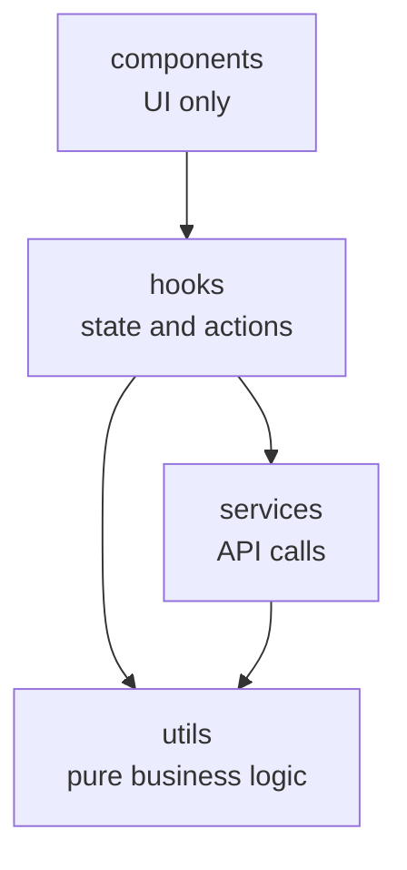

# React + Vite

This template provides a minimal setup to get React working in Vite with HMR and some ESLint rules.

Currently, two official plugins are available:

- [@vitejs/plugin-react](https://github.com/vitejs/vite-plugin-react/blob/main/packages/plugin-react) uses [Oxc](https://oxc.rs)
- [@vitejs/plugin-react-swc](https://github.com/vitejs/vite-plugin-react/blob/main/packages/plugin-react-swc) uses [SWC](https://swc.rs/)

## React Compiler

The React Compiler is not enabled on this template because of its impact on dev & build performances. To add it, see [this documentation](https://react.dev/learn/react-compiler/installation).

## Expanding the ESLint configuration

If you are developing a production application, we recommend using TypeScript with type-aware lint rules enabled. Check out the [TS template](https://github.com/vitejs/vite/tree/main/packages/create-vite/template-react-ts) for information on how to integrate TypeScript and [`typescript-eslint`](https://typescript-eslint.io) in your project.


# EN
# 🍽️ Meal List

A responsive food-ordering web app built with **React**. Users browse a menu fetched from a REST API, add meals to a cart, adjust quantities, and confirm their order.

The project is structured with a **layered architecture** (services, utils, hooks, components) to keep network logic, business rules, state management, and UI cleanly separated.

[**Live Demo**](#) · [**Report a Bug**](../../issues)

<!-- Add a screenshot or GIF here -->
<!--  -->

---

## ✨ Features

- Browse meals fetched from a REST API
- Add to cart, increase/decrease quantity, and remove items
- Live cart count and order total
- Order confirmation modal with an itemized summary
- "Thank you" screen and a new-order flow
- Loading (spinner), error (with retry), and empty-cart states
- Fully responsive layout: mobile, tablet, and desktop

---

## 🛠️ Tech Stack

| Area | Technology |
|---|---|
| UI | React (functional components, hooks) |
| Build tool | Vite |
| Styling | CSS3 (Grid, Flexbox, media queries) |
| Data | [DummyJSON Recipes API](https://dummyjson.com/docs/recipes) |

---

## 🏗️ Architecture

The app follows a layered structure where each layer has a single responsibility and depends only on the layers below it.



| Layer | Responsibility |
|---|---|
| `services/` | Network requests and response handling. No React, no UI. |
| `utils/` | Pure functions: cart operations, price calculations, formatting. |
| `hooks/` | Custom hooks that own state and expose actions to the UI. |
| `components/` | Presentational components that receive data and callbacks via props. |
| `App.jsx` | Composition root: wires hooks and components together. |

### Project Structure

```
src/
├── assets/img/
├── services/
│   └── recipeService.js        # fetch + response.ok check + price mapping
├── utils/
│   ├── price.js                # generatePrice, formatPrice
│   └── cartUtils.js            # add / increase / decrease / remove / totals
├── hooks/
│   ├── useRecipes.js           # data loading, loading/error state, refetch
│   └── useCart.js              # cart state and actions
├── components/
│   ├── common/                 # LoadingScreen, ErrorScreen
│   ├── recipes/                # RecipeList, RecipeCard
│   ├── cart/                   # Cart, CartItem
│   └── modals/                 # OrderConfirmedModal, ThankYouModal
├── App.jsx
├── App.css
└── main.jsx
```

---

## 💡 Key Design Decisions

- **Service layer for API calls.** The base URL, error handling, and data transformation live in one place, so components never know how data is fetched.
- **HTTP error handling.** `fetch` does not reject on 4xx/5xx responses, so the service checks `response.ok` and throws a meaningful error that the UI can display.
- **Pure cart functions.** Every cart operation takes the current cart and returns a new one without mutating the original. This makes the logic predictable and easy to unit test without React.
- **Custom hooks.** `useRecipes` and `useCart` keep components free of data-fetching and state-management code.
- **Generated prices.** The API provides no price field, so `generatePrice(id)` derives a deterministic price from the meal ID. Prices stay stable across reloads.
- **Mobile-first CSS.** Base styles target mobile, with media queries enhancing the layout for tablet and desktop.

---

## 🚀 Getting Started

### Prerequisites

- Node.js 18 or later
- npm (or yarn / pnpm)

### Installation

```bash
# Clone the repository
git clone https://github.com/<your-username>/<your-repo>.git

# Go to the project folder
cd <your-repo>

# Install dependencies
npm install

# Start the development server
npm run dev
```

The app will be available at `http://localhost:5173`.

### Available Scripts

| Command | Description |
|---|---|
| `npm run dev` | Start the development server |
| `npm run build` | Create a production build |
| `npm run preview` | Preview the production build locally |

---

## 🔌 API

Data comes from the public DummyJSON API:

```
GET https://dummyjson.com/recipes
```

Each recipe is enriched with a generated `price` field in `recipeService.js`.

---

## 🗺️ Roadmap

- [ ] Unit tests for `cartUtils.js` with Vitest
- [ ] Persist the cart in `localStorage`
- [ ] Search and cuisine filter
- [ ] Pagination using the API's `limit` and `skip` parameters
- [ ] Request cancellation with `AbortController`
- [ ] Split CSS into component-level files or CSS Modules
- [ ] Migrate to TypeScript

---

## 📄 License

This project is licensed under the MIT License.

---

## 👤 Author

**Your Name**
[LinkedIn](#) · [GitHub](#)
